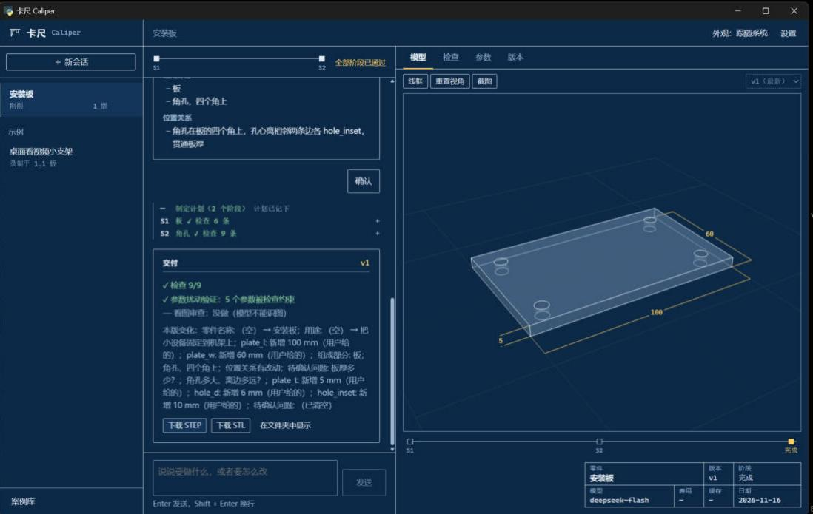

# Datum 基准

说出你要的零件，它来建模，每一步都实测。

卡尺是一个桌面应用：你用平常话描述一个零件，它先把需求问清楚，再分阶段用 [SimpleCADAPI](https://pypi.org/project/simplecadapi/)（下面简称 SCA）建模，每一步的尺寸都由程序在沙盒里真的建出来、量出来，模型说了不算。最后交付 STEP、STL 和参数化的源文件。名字的意思就是这个立场：拿卡尺量过才算数。



在线看一个示例（不用安装，只读）：<https://dingzhen-zhr.github.io/computer-graphics-project/demo/>

## 安装

Windows（在 PowerShell 里粘贴这一行）：

```powershell
irm https://raw.githubusercontent.com/DingZhen-zhr/computer-graphics-project/master/install.ps1 | iex
```

Mac（在"终端"里粘贴这一行）：

```sh
curl -fsSL https://raw.githubusercontent.com/DingZhen-zhr/computer-graphics-project/master/install.sh | sh
```

**系统要求：** Windows 10/11（64 位），或 Apple 芯片的 Mac（macOS 14 及以上）。不支持 Intel 芯片的 Mac（SCA 没有对应的安装包）和 Linux。需要一个大模型服务的 API key，推荐 DeepSeek。

安装脚本做五件事，每一步做之前都会先打印出来：

1. 检查系统和芯片，不支持就说明原因并退出，什么都不改。
2. 准备 [uv](https://docs.astral.sh/uv/)：电脑上没有就运行 uv 的官方安装脚本。不需要预先装 Python。
3. 用 uv 准备一个独立的 Python 3.12 环境，装上卡尺（第一次要下载几百 MB）。
4. 建快捷方式：Windows 是开始菜单和桌面上的"卡尺 Caliper"；Mac 是"应用程序"里的 Caliper。
5. 运行一次自检 `datum doctor`，把结果打印出来。

它只往当前用户的目录里写东西，不需要管理员权限。装好后，双击"卡尺 Caliper"打开；或者在终端里输入 `datum`（提示找不到时，关掉终端再开一个新的）。

**第一次打开**会进引导页：

1. 选模型服务（默认 DeepSeek）；
2. 粘贴 API key，点"测试连接"：key 存进系统钥匙串，不写进任何文件；
3. 完成。

任何一步都可以点"先看示例"跳过，示例会话不需要 key。

## 装不上怎么办

**连不上 GitHub 或 PyPI，或者下载很慢。** 改走国内镜像，PyPI 用清华的镜像，Python 用 npmmirror 的镜像：

```powershell
$env:CALIPER_MIRROR = "1"; irm https://raw.githubusercontent.com/DingZhen-zhr/computer-graphics-project/master/install.ps1 | iex
```

```sh
curl -fsSL https://raw.githubusercontent.com/DingZhen-zhr/computer-graphics-project/master/install.sh | CALIPER_MIRROR=1 sh
```

脚本里每一次下载都有 20 秒的连接超时，不会一直卡着。uv 本身是从它的官网下载的，镜像管不到这一步。

**GitHub 完全打不开：下载压缩包在本地装。**

1. 想办法拿到本仓库发布标签 `v2.0.0` 的压缩包（GitHub 页面上的 Code → Download ZIP，或者找别人拷一份），解压。
2. 把 `CALIPER_SOURCE` 指到解压出来的目录，再运行目录里的安装脚本。

Windows：

```powershell
$env:CALIPER_SOURCE = "D:\下载\computer-graphics-project-2.0.0"
Get-Content -Raw -Encoding UTF8 D:\下载\computer-graphics-project-2.0.0\install.ps1 | iex
```

Mac：

```sh
CALIPER_SOURCE=~/Downloads/computer-graphics-project-2.0.0 sh ~/Downloads/computer-graphics-project-2.0.0/install.sh
```

在 Windows 上，本地的 `install.ps1` 要用上面这种"按 UTF-8 读进来再执行"的写法，不要用 `powershell -File install.ps1`。Windows 自带的 PowerShell 5.1 会按系统编码读文件，中文会乱。

**电脑上没有 git。** 不用管：脚本发现没有 git，会自动改为下载同一个版本的压缩包来装。

**另外两个开关：**

- `CALIPER_NO_SHORTCUT=1`：不建快捷方式。
- `CALIPER_DRY_RUN=1`：只打印每一步要做什么，什么都不执行。

**提示"卡尺正在运行"。** Windows 不让替换正在运行的程序。关掉所有卡尺窗口，以及终端里运行着的 `datum`，再装一次。

**Windows 上窗口打不开（多见于 Windows 10）。** 通常是缺少 Microsoft Edge WebView2 运行时。到 <https://developer.microsoft.com/microsoft-edge/webview2/> 下载"常青版"装上。装好之前，可以先用 `datum --browser` 在默认浏览器里打开同样的界面。

**`datum doctor` 每一项是什么意思：**

| 项 | 查什么 | 不通过时 |
|---|---|---|
| `platform` | 系统和芯片在不在支持范围里 | 不能用 |
| `python` | Python 版本在 3.10 到 3.13 之间 | 不能用：重新运行安装命令 |
| `sca` | 能找到 simplecadapi，版本是 2.2.7 | 不能用：重新运行安装命令 |
| `sandbox` | 用沙盒真的建一个 10×20×30 的方块，量出来对不对 | 不能用 |
| `workdir` | 沙盒的工作目录是不是纯英文路径。用户名是中文时，系统临时目录会带中文，程序会自动改用 `C:\ProgramData\Datum\work` | 改用了备用目录是"需要注意"；备用目录也建不了才是"不能用" |
| `window` | 窗口组件能不能用（Windows 上还要有 WebView2） | 需要注意：先用 `datum --browser` |
| `keyring` | 系统钥匙串能不能写、读、删（用一条测试项，查完就删） | 需要注意：可以改用环境变量存 key |
| `data` | 数据目录能不能建、能不能写 | 不能用 |
| `provider` | 能不能连上设置里的模型服务（只建立连接，不发请求；`--offline` 时跳过） | 需要注意：检查网络和接口地址 |
| `key` | 有没有可用的 key，只说它来自环境变量还是钥匙串，不显示任何一位 | 需要注意：在设置里填，或者设环境变量 |

`datum doctor --json` 输出同样的内容，方便发给别人看。有"不能用"的项时返回码是 1。

## 怎么用

窗口分三栏：

- **左：会话。** 历史会话（零件名、时间、版本数），可以新建、改名、删除；点开旧会话可以接着做。底部是案例库。
- **中：对话。**
  - 回复逐字出现。
  - 工具调用显示成一棵树：阶段是树干，工具是分支。
  - 提问、确认需求单、交付各有一张卡片。
  - 运行时，发送按钮变成"停止"。
- **右：工作台。** 有模型、检查、参数、版本四个页签。右下角是图纸样式的标题栏：零件、版本、阶段、模型、费用、缓存命中率、日期。

一次完整的过程：

1. **提需求**：比如"做一个放在桌上看视频的小支架"。
2. **回答**：它先追问影响能不能用的关键尺寸，每个问题都给一个建议值，直接回答"可以"也行。
3. **确认**：需求单整理好以后会摆出来，包括：
   - 每个参数是你给的还是它建议的；
   - 各部分怎么相接（位置关系）。

   你点"确认"它才动手。
4. **规划**：把零件拆成几个阶段，每个阶段写明做完后零件上多了什么。
5. **逐阶段建模**：每个阶段先写检查、再写建模代码，程序真的建出来并测量；检查全过才进下一阶段。模型页签下面的阶段刻度可以点，看零件一个阶段一个阶段长出来。
6. **交付**：终检通过后存成一个版本。交付卡片上写着检查通过数、参数扰动验证和看图审查的结论，可以下载文件。

交付之后还可以：

- **直接改参数**：在"参数"页签里改数值（输入框或滑块），点"应用"。程序从第一个阶段起重新验证，通过就存成新版本，全程**不调用模型、不花钱**。没通过时数值退回原样；可以点"让助手处理"，把这次改动发给助手。
- **版本对比和导出**："版本"页签里勾两个版本，对比参数和截图；每个版本都能下载 STEP、STL、参数化源文件，或者在文件夹中显示。
- **存为案例**：填一个标题和标签，以后做相似零件时，规划阶段会参考它（只参考做法，尺寸以需求单为准）。
- **示例会话**：左栏"示例"里的"桌面看视频小支架"是 1.1 版的一次真实录制。它只读，不需要 key。

## 它是怎么保证质量的

**程序管流程，模型只做判断。** 需求单有没有确认、该不该进下一阶段、能不能交付，都由程序判定。模型只能调用我们定义的十几个工具，跳不过关卡。
- 拦得住：没确认就开工、跳过检查直接交付、改了需求不重新验证。
- 拦不住：模型把需求理解错了，而你也没看出来就点了确认。

**分阶段，先写检查再建模。** 每个阶段必须先写至少一条检查（尺寸、体积、某处有没有材料等），才能写这个阶段的特征。build 由程序在沙盒里真的运行、测量，检查全过才能往下走；同一阶段连续失败 3 次就停下，把原因告诉你。
- 拦得住：尺寸错、少了特征、建模代码运行出错。
- 拦不住：检查本身写错了。下面两条就是为它准备的。

**终检的参数扰动验证。** 最后一个阶段通过后，程序先确认每个你给的参数都至少被一条检查用到。然后把这些参数一个一个改掉（乘 1.2，整数加 1）重建模型，检查的期望值仍按原来的数字算：
- 至少一条检查不通过，说明这个参数真的管着几何，过关；
- 检查仍然全过，说明模型根本没用上这个参数，或者没有检查管它，退回给模型重做。

这一步不调用模型。
- 拦得住：参数改了几何不变；检查和参数无关。
- 拦不住：模型和检查"自洽地错"，比如两边都按叠放来算。

**看图审查。** 交付前，程序渲染四张图（等轴测、正视、俯视、右视），另开一次全新的模型调用，只给它需求单和这四张图，让它逐个部分、逐条位置关系回答"符合 / 不符合 / 看不出"。有"不符合"就退回，最多两轮；两轮后仍有异议，照常交付，但在交付卡片上标出来，由你判断。当前模型不能识图时自动跳过，并在卡片上写明"未做看图审查"。
- 拦得住：部件放错位置、方向反了这类一眼能看出的错。
- 拦不住：细小的尺寸差。另外它依赖审查模型的眼力，它也会看错。

## 命令

| 命令 | 作用 |
|---|---|
| `datum` | 打开桌面窗口 |
| `datum --browser` | 不开窗口，改用默认浏览器打开同样的界面（终端里按 Ctrl+C 退出） |
| `datum --cli` | 终端对话模式。不给 `--config` 时，用设置页里的服务和钥匙串里的 key |
| `datum doctor` | 自检，见上面的表；`--offline` 不连模型服务，`--json` 输出 JSON |
| `datum update` | 更新到最新发布：重新运行安装脚本覆盖安装，会话、设置和 key 都不受影响 |
| `datum uninstall` | 依次删除快捷方式、钥匙串里卡尺存的 key、问过你之后删除数据，最后让 uv 卸载程序本身。`--delete-data` 直接删数据，`--keep-data` 保留数据；不在终端里运行时不问，按保留处理 |
| `datum --version` | 显示版本号 |

## 模型服务和密钥

**支持的服务**（在设置页里选）：

- DeepSeek（默认，重点调优）；
- 智谱 GLM、Kimi、通义千问；
- OpenAI；
- Claude（官方接口）；
- 自定义地址（任何 OpenAI 兼容的接口）。

各家的地址和建议的模型名都对照官方文档核实过（`cad_agent/providers.toml`），模型名也可以自己改。代码里不写任何价格；想看费用，到设置里照服务的价目页填。

**key 存在哪：**

- 在界面里填的 key 存进系统钥匙串（Windows 凭据管理器 / Mac 钥匙串），服务名 `datum`，用户名是服务的编号，比如 `deepseek`。
- 也可以用环境变量，环境变量优先。每家的变量名不同，比如 `DEEPSEEK_API_KEY`、`ANTHROPIC_API_KEY`，设置页里有写。
- key 不写进任何文件、日志、会话记录；界面上只显示最后四位。

**怎么换、怎么删：**

- 在设置页里点"更换"或"删除"；
- `caliper uninstall` 会删掉钥匙串里卡尺存的全部 key；
- 环境变量里的 key 是你自己设的，卡尺不动它。

**哪些没有用真实接口验证过（未用真实接口验证）：**

- **Claude** 官方接口：只用假服务端做过单元测试，接口细节见 `docs/llm-api-notes.md` 第 8 节。
- **DeepSeek 以外的预设**（智谱 GLM、Kimi、通义千问、OpenAI、自定义地址）：地址和模型名是照官方文档写的，没有拿真实的 key 跑过。
- **看图审查**：整个流程是用假模型测的。DeepSeek 能不能识图没有实测，默认按不能识图处理；设置页里的"测试识图"会花你自己几厘钱，要你自己点。

## 数据放在哪

- Windows：`%LOCALAPPDATA%\Datum`；Mac：`~/Library/Application Support/Datum`。可以用环境变量 `DATUM_HOME` 改到别处。
- 里面有：`settings.toml`（除 key 以外的全部设置）、`sessions/`（每个会话一个目录）、`cases/`（你存的案例）、`logs/`（程序日志）。
- 一个会话目录里有：
  - `log.jsonl`：每条消息、工具调用、结果、耗时、token，以及启动时的软件和模型版本；
  - `brief.json`（需求单）、`plan.json`（计划）、`features.json`、`checks.json`；
  - `versions/v1/`、`v2/`…：每个版本的 `model.py`（参数化源文件，可以用 `sca edit` 打开）、`model.step`、`model.stl`、`view.png`、检查结果，以及各阶段的 STL。
- 沙盒运行时的临时文件放在系统临时目录；那个目录带中文时，改放在 `C:\ProgramData\Datum\work`。
- 程序本身由 uv 管理：Windows 在 `%APPDATA%\uv\tools\datum-cad`，命令在 `%USERPROFILE%\.local\bin`；Mac 在 `~/.local/share/uv/tools/datum-cad`，命令在 `~/.local/bin`。

## 给开发者

**从源码运行**（Windows PowerShell，Python 3.10–3.13）：

```powershell
python -m venv .venv
.venv\Scripts\python -m pip install -e ".[dev]"
.venv\Scripts\datum                                                # 桌面窗口
.venv\Scripts\datum --demo-script scripts\demo_script.json         # 模型换成假模型剧本，不需要 key、不花钱，沙盒是真的
.venv\Scripts\python -m cad_agent --config config.toml             # 旧的命令行用法，评测脚本也用它
```

所有命令都用 `.venv\Scripts\python`，不要往系统 Python 里装包。`config.example.toml` 里写了全部配置项。

**跑测试：**

```powershell
.venv\Scripts\python -m pytest -q                # 全部测试（含真实 SCA 的，大约 10 分钟）
.venv\Scripts\python -m pytest -q -m "not sca"   # 跳过需要真实运行 SCA 的较慢测试
```

测试全部用假模型和沙盒，不联网、不花钱，钥匙串用内存里的假后端。GitHub Actions 每次推送都在 Windows 和 Apple 芯片的 Mac 上跑全部测试，再用源码跑一遍安装脚本、自检和无窗口启动（`.github/workflows/ci.yml`）。

**评测脚本**：`benchmarks/` 里有 11 个任务，分三档：

- 简单 5 个：手机支架、法兰盘、L 形支架、电路板小盒、阶梯轴；
- 中等 3 个：轴承座、电池盒、直齿轮；
- 困难 3 个：散热器、三通管接头、支架臂。

每个任务有一句话的初始需求、"用户心里的完整需求"、修改请求和人工写的验收检查，由一个模拟用户（也是大模型）扮演提需求的人。

```powershell
.venv\Scripts\python -m benchmarks.run --config config.toml --set v2 --repeat 1 --budget 15
```

这是备好的 **¥15 以内的评测套餐**：11 个任务各跑 1 遍，开着案例库，累计花费到 ¥15 就不再开始新任务。

- **这条命令会调用真实的大模型，会花钱。** 什么时候运行，由你自己决定；开发和测试过程中都没有运行过它。
- 跑之前要先在 `config.toml` 的 `[llm.pricing]` 里照价目页填好价目表，否则 `--budget` 直接报错退出。
- 其他参数：
  - `--set dev|holdout|medium|hard|v2|all` 选任务；
  - `--cases on|off` 做"有案例库 / 无案例库"的对照；
  - `python -m benchmarks.compare 旧\results.json 新\results.json` 对比两次结果。

**项目结构：**

```text
cad_agent/
  app.py  doctor.py  maintenance.py   datum 命令、自检、更新和卸载
  agent/  staged/  tools.py  gates.py 主循环、分阶段流程、工具、关卡
  checks/  sandbox/                   检查格式和测量、沙盒（静态检查 + 子进程）
  llm/  providers.toml  keystore.py  settings.py   模型接口、服务预设、钥匙串、设置
  desk/                               桌面端：本机服务、事件流、页面（static/）、静态导出（export.py）
  case_data/                          自带的 8 个案例
benchmarks/  scripts/  tests/  site/（产品主页和在线示例）
install.ps1  install.sh               一行安装脚本
docs/        设计文档、实施计划、各种实测笔记、偏离记录、进度记录
```

**四个流程开关**写在配置文件的 `[agent]` 里，默认全开，可以逐个关掉做对照：

```toml
[agent]
staged = true          # 分阶段流程；关掉就退回 1.2 版的单阶段流程
mutation_check = true  # 终检的参数扰动验证
visual_review = true   # 看图审查
cases = true           # 案例库
```

桌面端的设置页里也能改这四个开关。

## 验证到什么程度

- **测试**：全部测试在 Windows 和 Mac（GitHub Actions，`macos-15`，Apple 芯片）上通过。持续集成里还用源码跑了安装脚本、`datum doctor --offline`、无窗口启动，并且再装一次。
  - 持续集成的 Mac 机器是 macOS 15。GitHub 已经不提供 Apple 芯片的 macOS 14 了，所以 macOS 14 本身没有自动测试。
- **Windows 实机**：在一台 Windows 11 上走过完整流程，用的是假模型剧本加真实的 SCA 沙盒，记录在 `docs/walkthrough-windows.md`。也在这台电脑上用安装脚本实际装过，见 `docs/install-notes.md`。
- **Mac 界面**：还没有人工看过，等有 M 芯片 Mac 的组员按 `docs/mac-checklist.md` 做一遍。
- **成功率**：第二版没有做过真实模型的成功率评测。上面这些证明的是"关卡按设计工作、流程表达得了这些零件"，不证明"真模型做得好"。第 1.1 版的真实评测结果在 `docs/results-v1.1.md`；第二版的数字要等运行了上面的 ¥15 套餐之后才有。
- **已知的限制：**
  - 只做单个零件，不做装配体；
  - 不支持 Intel 芯片的 Mac 和 Linux；
  - 用户名是中文的 Windows 没有实机测过（程序会自动改用纯英文的工作目录，自检会查这一项）；
  - 国内镜像只核对过镜像上能找到对应的文件，没有在一台全新的电脑上完整走过一遍；
  - Windows 上窗口左上角的小图标是 Python 的默认图标；
  - 界面只有中文。

## 参考与致谢

- [SimpleCADAPI](https://github.com/PhySpace/SimpleCADAPI)（Apache License 2.0）：建模内核。卡尺借鉴了它安装包里自带的官方 Agent Skill 的方法：分阶段、先定验证再建模、用故意做错的例子证明检查有效、渲染图交给没参与建模的审查者。这些文档在运行时从用户本机的 SCA 安装包里按需读取，没有复制进本仓库。工具定义、流程和关卡、检查和测量、参数扰动验证、沙盒、界面都是自己写的。
- [three.js](https://threejs.org/) r160（MIT 许可证）：3D 视图。
- [uv](https://docs.astral.sh/uv/)：安装脚本用它准备 Python 环境。
- [pywebview](https://pywebview.flowrl.com/)：桌面窗口。
- 课程作业：[AICG Project 3](https://github.com/syby119/AICG-projects/tree/main/projects/project3)。设计和计划文档在 `docs/superpowers/`。
